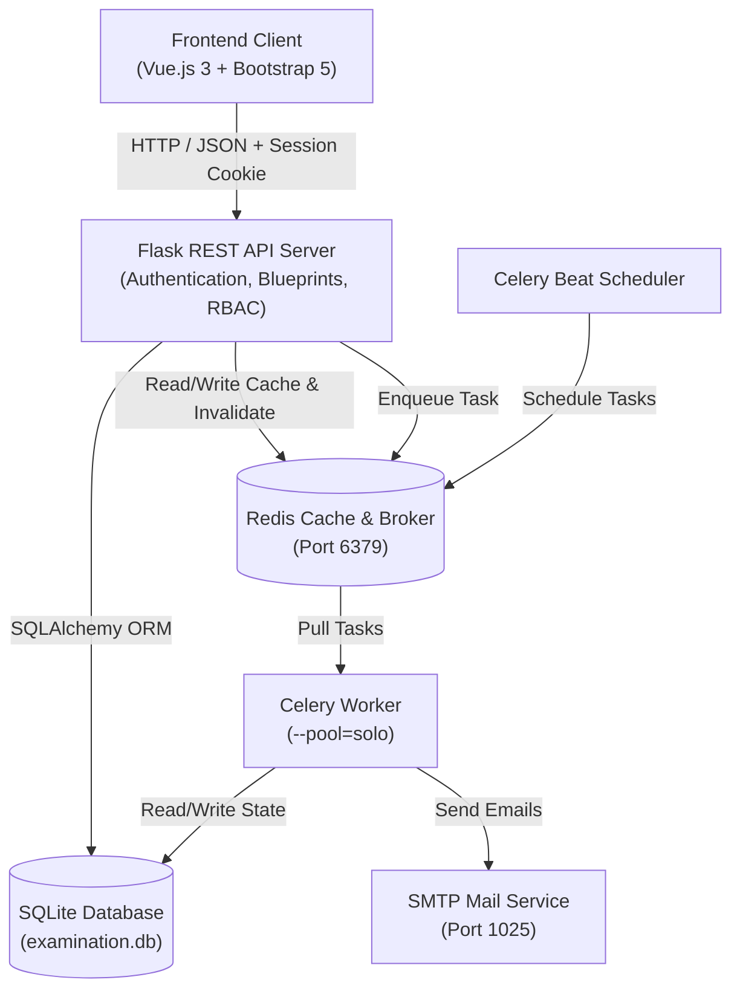
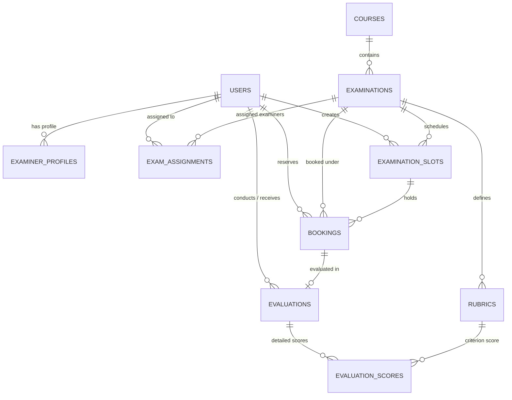

# Project Report: Examination Management Portal V2 (EMP-V2)
**Course:** Modern Application Development II (MAD-2) — IIT Madras  
**Term:** September 2026

---

## 1. Student and Project Metadata

- **Student Name:** [Student Name]
- **Roll Number:** [Student Roll Number]
- **Project Title:** Examination Management Portal V2 (EMP-V2)
- **Problem Statement:** Web-based examination portal managing scheduling, slot reservations, rubric evaluations, batch notifications, and result publishing across Administrators, Examiners, and Students.
- **Video Presentation Link:** `[Insert Google Drive link to 5–10 min video with view access]`

---

## 2. Declaration on Use of AI / LLM Tools

In accordance with IITM academic integrity guidelines:
- **Tools Utilized:** Google Antigravity AI / VS Code AI development assistants.
- **Extent of Usage:**
  1. Assisted in generating unit tests and test scaffolding (`tests/`).
  2. Suggested standard Celery configuration patterns and Beat scheduler integration.
  3. Assisted in formatting Bootstrap HTML templates and docstrings.
- **Student Understanding & Ownership:**
  All core database models, business logic (concurrency control, atomic booking decrement, foreign key relationships, session authentication, and background jobs) have been independently verified, tested, and understood by the student to explain and defend during the project viva.

---

## 3. Technology Stack & Frameworks

| Layer | Technology | Justification |
|---|---|---|
| **Backend Framework** | Python 3.12, Flask 3.1.3 | Lightweight, permitted RESTful API framework. |
| **Database** | SQLite, Flask-SQLAlchemy 3.1.1 | Relational database created programmatically with foreign key constraints. |
| **Authentication** | Flask-Session, CacheLib | Server-side session storage with session fixation defense. |
| **Frontend UI** | Vue.js 3 (CDN), Bootstrap 5.3 | Reactive single-page application without complex bundlers or disallowed CSS. |
| **Background Processing** | Celery 5.7.0, Celery Beat | Asynchronous task queues and recurring cron-style job scheduler. |
| **Cache & Message Broker** | Redis 8.1.0 | Fast in-memory key-value store for Celery broker, result backend, and caching. |
| **Testing** | Standard Python `unittest` | 74 automated unit and integration tests. |

---

## 4. System Architecture



---

## 5. Database Design & Entity Relationships

The relational schema is defined programmatically in `backend/models/`:



### Table Definitions:
1. **`users`:** Unified user model (`id`, `email`, `password_hash`, `full_name`, `role`). Role is `'admin'`, `'examiner'`, or `'student'`.
2. **`examiner_profiles`:** Supplementary profile (`department`, `contact_details`).
3. **`courses`:** Course details (`course_code`, `course_name`, `description`, `status`).
4. **`examinations`:** Examination metadata and timelines (`duration_minutes`, `max_marks`, `slot_creation_start_date`, `slot_creation_end_date`, `slot_booking_start_date`, `slot_booking_end_date`, `status`).
5. **`exam_assignments`:** Many-to-many relationship mapping examiners to examinations.
6. **`rubrics`:** Evaluation criteria (`criterion_name`, `max_marks`, `description`).
7. **`examination_slots`:** Time slots created by examiners (`exam_date`, `start_time`, `end_time`, `max_capacity`, `available_seats`, `status`). Enforces `CHECK(available_seats >= 0)`.
8. **`bookings`:** Reservations made by students (`booking_date`, `status`). Enforces partial unique index `uq_student_active_booking` to restrict students to one active reservation per exam.
9. **`evaluations`:** Examiner grading records (`total_marks`, `remarks`, `evaluation_date`, `status`).
10. **`evaluation_scores`:** Normalized criterion-level marks mapped to rubrics (`marks_obtained`).

---

## 6. Implementation Highlights

### A. Atomic Slot Booking & Concurrency Protection
To prevent overbooking in high-concurrency environments, seat allocation executes as an atomic database-level update:
```sql
UPDATE examination_slots
SET available_seats = available_seats - 1,
    status = CASE WHEN available_seats - 1 = 0 THEN 'Full' ELSE 'Available' END
WHERE id = :slot_id AND available_seats > 0 AND status = 'Available';
```
If zero rows are updated, the booking request is rejected with `HTTP 400`. If any subsequent insert fails, the transaction is rolled back completely.

### B. Background Jobs (Celery + Redis)
1. **Daily Examination Reminders:** Runs daily at 08:00 AM IST via Celery Beat. Identifies students booked for slots occurring the next day (`exam_date == tomorrow`) where `Booking.status == 'Booked'`. Sends multipart plain-text and HTML emails with exam, timing, and examiner details. Deduplicates via Redis (`reminder_sent:<booking_id>:<exam_date>`) to prevent multiple alerts.
2. **Monthly Admin Report:** Runs on the 1st of every month at 09:00 AM IST. Aggregates system metrics (examinations, bookings, completed evaluations, examiner activity table) and dispatches an HTML report to the Admin.
3. **Asynchronous Student CSV Export:** Students click "Export History" in the portal, initiating `export_student_csv.delay(student_id)`. The task runs in the background, writing the 6 mandatory columns (`Examination Name`, `Course`, `Examination Date`, `Examiner`, `Marks Obtained`, `Booking Status`) into `backend/exports/`. The download endpoint strictly verifies student ownership (`HTTP 403` on unauthorized access).

### C. Performance & Caching
Public examination listings (`GET /api/student/examinations`) are cached in Redis with a 60-second TTL. When an Administrator modifies courses or examinations, `invalidate_exam_cache()` purges matching keys immediately. Student-specific booking statuses are computed dynamically per request to ensure private student information is never leaked via shared cache keys.

---

## 7. API Resource Endpoints Summary

| Method | Endpoint | Allowed Role | Purpose |
|---|---|:---:|---|
| `POST` | `/api/auth/register` | Public | Student self-registration |
| `POST` | `/api/auth/login` | Public | Common login for Admin, Examiner, Student |
| `POST` | `/api/auth/logout` | Logged In | Destroys server-side session |
| `GET` | `/api/auth/me` | Logged In | Returns logged-in user profile & CSRF token |
| `GET` | `/api/admin/dashboard` | Admin | Dashboard summary counts |
| `POST/PUT/DELETE` | `/api/admin/courses` | Admin | Course CRUD |
| `POST/PUT/DELETE` | `/api/admin/examinations` | Admin | Examination CRUD & timelines |
| `PUT` | `/api/admin/examinations/<id>/status` | Admin | Manual lifecycle overrides |
| `POST/PUT/DELETE` | `/api/admin/examinations/<id>/rubrics` | Admin | Rubric criteria management |
| `POST` | `/api/admin/examiners` | Admin | Create examiner account |
| `POST` | `/api/admin/examinations/<id>/examiners`| Admin | Assign examiner to exam |
| `POST` | `/api/admin/bookings/<id>/reschedule` | Admin | Atomic student rescheduling |
| `GET` | `/api/examiner/examinations` | Examiner | List assigned examinations |
| `POST/PUT/DELETE` | `/api/examiner/slots` | Examiner | Slot CRUD |
| `GET` | `/api/examiner/booked-students` | Examiner | List students booked into slots |
| `POST` | `/api/examiner/bookings/<id>/evaluate` | Examiner | Submit rubric evaluation |
| `PUT` | `/api/examiner/slots/<id>/complete` | Examiner | Mark slot completed |
| `GET` | `/api/student/examinations` | Student | Search and view exams (cached) |
| `POST` | `/api/student/book` | Student | Atomic slot booking |
| `POST` | `/api/student/bookings/<id>/cancel` | Student | Cancel booking prior to deadline |
| `GET` | `/api/student/results` | Student | View evaluated scores & remarks |
| `POST` | `/api/student/export` | Student | Trigger asynchronous CSV export |
| `GET` | `/api/student/export/status/<task_id>` | Student | Check CSV export task status |
| `GET` | `/api/student/export/download/<task_id>`| Student | Download generated CSV file |

---

## 8. Testing and Quality Assurance

A comprehensive test suite of **74 unit and integration tests** was developed:
- `tests/test_phase2_db.py`: 6 tests (models, foreign keys, capacity constraints, admin seeding)
- `tests/test_phase3_auth.py`: 11 tests (registration, login, logout, session persistence, fixation, CSRF)
- `tests/test_phase4_admin.py`: 11 tests (Admin CRUD, timelines, overrides, rescheduling, search)
- `tests/test_phase5_examiner.py`: 11 tests (Examiner slots, capacity validation, rubric grading)
- `tests/test_phase6_student.py`: 22 tests (search, atomic booking, cancellation, overbooking protection)
- `tests/test_phase7_tasks.py`: 13 tests (Celery init, Redis config, reminder dedup, report, CSV export, cache TTL)

**Final Test Execution:**
```
Ran 74 tests in 43.910s — OK (All 74 tests passed, 0 failures, 0 errors)
```

---

## 9. Conclusion

The Examination Management Portal V2 fulfills all mandatory functional, architectural, and submission requirements set forth in the IITM MAD-2 project guidelines. The portal demonstrates robust data integrity, secure role-based access control, atomic booking management, efficient Redis caching, and reliable background task execution using Celery.

